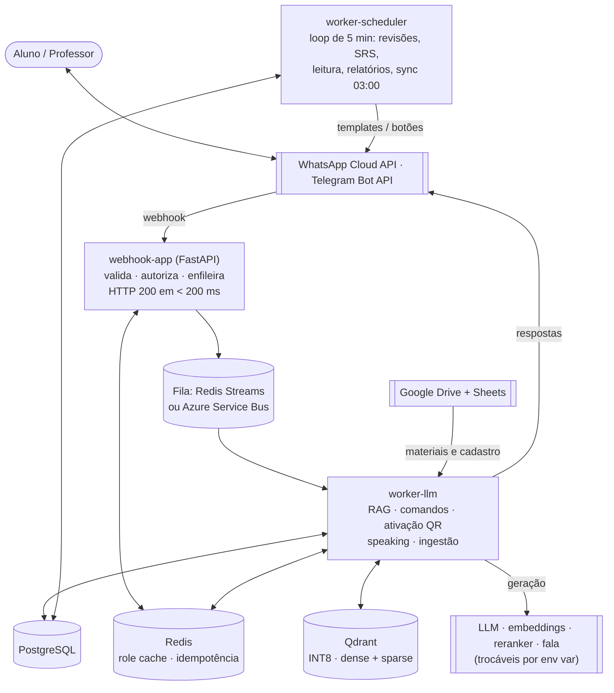

# Teacher Assistant — Assistente de Ensino via WhatsApp e Telegram

Assistente pedagógico que combate a **curva do esquecimento**: entre uma aula e outra, o aluno recebe revisões, quizzes, microdoses de leitura e revisão espaçada **no app de mensagens que já usa** (WhatsApp e/ou Telegram) e tira dúvidas com respostas ancoradas no material do professor. Não há app nem painel para instalar.

O professor também não precisa de plataforma: organiza os materiais numa pasta do **Google Drive**, mantém turmas e alunos numa **planilha** e conduz o curso por **comandos de chat** (`/aula`, `/quiz`, `/sinc_materiais`, `/engajamento`…).


---

## Sumário

- [Funcionalidades](#funcionalidades)
- [Arquitetura](#arquitetura)
- [Stack](#stack)
- [Estrutura do repositório](#estrutura-do-repositório)
- [Rodando localmente](#rodando-localmente)
- [Configuração e feature flags](#configuração-e-feature-flags)
- [Testes e qualidade](#testes-e-qualidade)
- [Deploy](#deploy)
- [Comandos de chat](#comandos-de-chat)
- [Documentação complementar](#documentação-complementar)

---

## Funcionalidades

**Núcleo**
- **Revisões e quizzes proativos** agendados por turma, respeitando a janela de 24h da Meta (template pago só para abrir a janela, o conteúdo do dia segue dentro dela).
- **Tira-dúvidas com RAG socrático**, escopado ao curso e à aula atual do aluno.
- **Omnichannel**: WhatsApp (Meta Cloud API) e Telegram atrás de uma interface única (`IMessagingChannel`). A entrega proativa segue o aluno no canal onde ele falou por último.
- **Analytics para o professor**: engajamento, taxa de acerto, alunos em risco, dúvidas frequentes.

**Livros e apostilas (Addon + Horizontes H1–H3)**
- Jornada de leitura guiada com microdose diária e quiz de check-in.
- Revisão espaçada automática (D+3 / D+10 / D+30) servida pelo Banco de Questões (cache com custo marginal zero).
- Ativação self-service por **QR Code** (o leitor escaneia o QR do livro e vira aluno), desafios de turma com placar anônimo, correção de redação por foto ancorada na rubrica do professor, sentinela emocional e relatório editorial mensal.

**RAG de alta precisão (F0–F8)**
- Funil medido: chunking estrutural → enriquecimento contextual → busca híbrida densa+esparsa (RRF) → rerank cross-encoder → **CRAG-lite com Recusa Honesta** (sem evidência suficiente, o bot não inventa e avisa o professor).
- Toda troca de modelo ou limiar é justificada pelo harness de avaliação (`scripts/eval_rag.py` + [golden set](tests/golden/README.md)).

**Verticais**
- **Idiomas**: quando o curso é de idioma (detectado pelo **nome**), o mesmo pipeline vira tutor com áudio de entrada e saída (listening, vocabulário com SRS, avaliação de pronúncia, nivelamento CEFR, roleplay, exam prep). A camada de fala é provider-agnóstica e sempre degrada para texto.
- **Exatas**: parser ciente de matemática (Markdown+LaTeX, com fallback para Azure DI), chunking que nunca quebra uma fórmula, renderização de fórmulas como imagem e gráficos de funções gerados de forma determinística (sympy→numpy→matplotlib). Nenhum código produzido pelo LLM é executado.
- **Gamificação**: XP, streaks, medalhas e ligas anônimas por coorte, ativadas **por turma** na planilha. Tudo determinístico, sem chamada de LLM e sem custo por mensagem.

**LGPD por design**
- Minimização de PII antes do LLM, consentimento de responsável, `/apagar_meus_dados`, retenção configurável, opt-out de mensagens (`SAIR`) não condicionado a flag.
- Áudio de voz é **descartado após a análise**; só os scores de pronúncia são persistidos.

---

## Arquitetura



Princípios que regem o código:

- **A borda não pensa.** O webhook só valida assinatura (HMAC / secret token), resolve o papel do remetente pelo Redis, roteia e enfileira. Nenhuma chamada a LLM, nenhum download de mídia: fotos e notas de voz seguem como `media_id` e são baixadas no worker.
- **Isolamento por curso.** Toda consulta SQL e vetorial filtra por `teacher_id` **e** `course_id` antes da similaridade.
- **Provider-agnóstico.** LLM, embeddings, reranker, parser de documentos, fala, fila, canal e fonte de material são portas com registro + variável de ambiente. Trocar o LLM de geração não exige reindexar.
- **Flags OFF = comportamento clássico.** Toda camada nova (RAG de precisão, idiomas, exatas, gamificação) nasce desligada e com fallback para a camada anterior. Com tudo desligado, o System Prompt e a entrega ficam idênticos byte a byte, e isso é coberto por teste.
- **Nenhuma camada derruba a resposta.** Híbrido cai para denso, rerank cai para a ordem da fusão, fala cai para texto, gráfico inválido é descartado e o texto segue.

---

## Stack

| Camada | Tecnologia |
|---|---|
| Linguagem | Python 3.12, async de ponta a ponta |
| API | FastAPI + uvicorn |
| LLMs | DeepSeek · Gemini · OpenAI (`DEFAULT_LLM_PROVIDER`) |
| Embeddings | Azure OpenAI · OpenAI · BGE-M3 híbrido · Ollama (`DEFAULT_EMBEDDER_PROVIDER`) |
| Reranker (opcional) | Cohere · Voyage · endpoint compatível com TEI (`RERANKER_PROVIDER`) |
| Banco vetorial | Qdrant (quantização escalar INT8, IDs uuid5 determinísticos) |
| Parsing | Azure Document Intelligence · Marker self-hosted (exatas) · Gotenberg (Office→PDF) |
| Fala (idiomas) | Azure Speech · Whisper · Google · ElevenLabs |
| Fila | Redis Streams (padrão) ou Azure Service Bus |
| Dados / cache | PostgreSQL (asyncpg + Alembic) · Redis |
| Observabilidade | structlog (JSON) + Application Insights |
| Infra | Azure Container Apps + KEDA, Bicep, Key Vault (Managed Identity) |

---

## Estrutura do repositório

```
src/
├── webhook/      # FastAPI: endpoints WhatsApp/Telegram, segurança, Partner API (B2B)
├── workers/      # llm, scheduler, ingestion + addon de livros, idiomas, gamificação, LGPD
├── rag/          # funil de recuperação, Qdrant, CRAG, splitter, geração de quiz/revisão
├── llm/          # factory e providers de LLM, embeddings, reranker, classificador
├── speech/       # STT, avaliação de pronúncia, TTS (vertical de idiomas)
├── math/         # vertical de exatas: roteamento, renderização, entrega, gráficos
├── gamification/ # regras puras de XP, streak, medalhas e ligas (sem I/O)
├── channel/      # IMessagingChannel: WhatsApp, Telegram
├── queue/        # IMessageQueue: Redis Streams, Service Bus
├── parsing/      # registro IDocumentParser: Azure DI, local, Marker
├── drive/        # sincronização com Google Drive e planilha
├── db/           # engine, modelos SQLAlchemy
├── cache/        # Redis: debounce, histórico de conversa, caches de tópicos
└── shared/       # config (todas as flags), telemetria, prompts, mensagens, comandos
scripts/          # eval_rag, reindex_all, seeds, simulador, ferramentas de DLQ
tests/
├── unit/         # testes puros (sem rede/DB/Redis), o gate do `make ship`
├── golden/       # golden set e resultados do eval de RAG
└── e2e/          # simulador ponta a ponta
alembic/          # migrações do PostgreSQL
infra/            # Bicep (Azure), scripts GCP/AWS, KEDA
docker/           # reranker local com GPU, Caddy (deploy Oracle)
```

---

## Rodando localmente

### Pré-requisitos

- Python 3.12
- Docker + Docker Compose
- Um bot do Telegram (caminho mais simples para testar) e/ou um app na Meta com WhatsApp Cloud API
- [ngrok](https://ngrok.com/) para expor o webhook local
- Chave de pelo menos um provedor de LLM (DeepSeek, Gemini ou OpenAI) e de um embedder

### Passo a passo

```bash
# 1. Ambiente Python
python3.12 -m venv .venv
.venv/bin/pip install -r requirements.txt

# 2. Variáveis de ambiente
cp .env.local.example .env.local   # preencha os <set-me>
make env-local                     # copia .env.local → .env

# 3. Infra local: Redis, PostgreSQL, Qdrant, Gotenberg (+ reranker com GPU)
make dev
#    Sem GPU NVIDIA, suba só o essencial:
#    docker compose up -d redis postgres qdrant gotenberg

# 4. Banco
make db-upgrade                    # alembic upgrade head
make dev-seed                      # opcional: dados fictícios (recusa rodar contra banco remoto)

# 5. API + workers + ngrok (registra o webhook do Telegram automaticamente)
make start
```

Para rodar as peças separadamente:

```bash
make dev-api                 # webhook em http://localhost:8000
make dev-worker-llm          # worker de mensagens, comandos e ingestão
make dev-worker-scheduler    # agendador proativo
```

**Sem Google Drive:** defina `MATERIAL_SOURCE_BACKEND=local` e `REGISTRY_BACKEND=local_csv` para ler materiais de `data/materials/` (árvore `Curso/Disciplina/[Aulas|Livro|Apostila]/Seção/`) e o cadastro de CSVs em `data/registry/` (`Professores.csv`, `Alunos.csv`, `Turmas.csv`, `Chaves.csv`).

**WhatsApp:** o webhook da Meta é registrado manualmente no painel do app, apontando para `https://<seu-ngrok>/v1/webhook/whatsapp` com o `META_VERIFY_TOKEN`.

**Telegram:** o `setWebhook` precisa enviar `secret_token=TELEGRAM_WEBHOOK_SECRET`; sem ele, o app rejeita todas as requisições. O `make start` já faz isso.

### Endpoints

| Método | Rota | Uso |
|---|---|---|
| `GET`/`POST` | `/v1/webhook/whatsapp` | Verificação e eventos da Meta |
| `POST` | `/v1/webhook/telegram` | Updates do Telegram |
| `GET` | `/health` | Health check |
| `POST`/`GET` | `/v1/partner/{keys,stats,language_class,proficiency}` | Partner API (editoras e escolas parceiras) |

---

## Configuração e feature flags

Toda a configuração vive em [src/shared/config.py](src/shared/config.py) e é lida de variáveis de ambiente. O arquivo [.env.local.example](.env.local.example) lista todas, com os valores padrão. Em produção, credenciais vêm do Azure Key Vault via Managed Identity, nunca como variável de ambiente em texto puro.

Todas as famílias de flags **começam desligadas**:

| Família | Flags principais |
|---|---|
| RAG de precisão | `CONTEXTUAL_RETRIEVAL_ENABLED`, `HYBRID_SEARCH_ENABLED`, `RERANKER_PROVIDER`, `CRAG_LITE_ENABLED`, `LONG_CONTEXT_ENABLED` |
| Idiomas | `LANGUAGE_MODE_ENABLED` (mestra), `SPEECH_INPUT_ENABLED`, `TTS_ENABLED`, `VOCABULARY_SRS_ENABLED`, `ROLEPLAY_ENABLED`, `PLACEMENT_TEST_ENABLED`, `PROFICIENCY_REPORT_ENABLED`, `EXAM_PREP_ENABLED` |
| Exatas | `MATH_INGESTION_ENABLED`, `MATH_MODE_ENABLED`, `MATH_RENDERING_ENABLED`, `CHART_GENERATION_ENABLED` |
| Gamificação | `GAMIFICATION_ENABLED` (mestra), `XP_LEDGER_ENABLED`, `STREAK_ENABLED`, `BADGES_ENABLED`, `LEADERBOARD_ENABLED`, `WEEKLY_DIGEST_ENABLED`, `GRADE_COMPONENT_ENABLED` |
| LGPD | `LLM_PII_MINIMIZATION` (ligada), `GUARDIAN_CONSENT_ENABLED`, `DATA_RETENTION_ENABLED` |

Para testar uma feature, ligue **uma flag por vez** e preencha o segredo do provider correspondente. Provider ausente ou sem chave resulta em degradação para texto ou para a camada anterior, nunca em erro para o aluno.

> Mudanças que alteram o índice (chunking, enriquecimento contextual, embedder, vetores esparsos) entram atrás de flag e são aplicadas numa **única reindexação** via `scripts/reindex_all.py`, sempre fora do horário de pico (03:00 BRT).

---

## Testes e qualidade

```bash
make test                         # pytest tests/unit/ (testes puros, sem I/O)
ruff check src/ tests/            # lint
mypy src/ --ignore-missing-imports
```

O CI (GitHub Actions) roda ruff → mypy → pytest a cada push na `main`.

**Qualidade do RAG:** nenhuma escolha de embedder, reranker ou limiar é feita "no feeling". O harness mede o funil por estágio contra o golden set curado:

```bash
python scripts/eval_rag.py --stage dense     # dense | hybrid | rerank | crag
```

Detalhes do formato e das categorias em [tests/golden/README.md](tests/golden/README.md). O eval precisa de Qdrant e das credenciais do embedder.

---

## Deploy

**Produção (Azure Container Apps).** Três apps a partir de duas imagens: `webhook-app` (`Dockerfile.webhook`, mínimo de 1 réplica para cumprir o SLA da Meta), `worker-llm` e `worker-scheduler` (`Dockerfile.worker`, selecionados por `WORKER_TYPE`). O worker LLM escala por KEDA conforme o tamanho da fila.

```bash
make ship          # pytest → git push → build no ACR → atualiza os Container Apps
make deploy-infra  # provisiona/atualiza a infra via Bicep
```

O deploy é feito **localmente** (`make ship`, com `az login`). A assinatura Azure for Students não permite Service Principal, então o job de deploy do GitHub Actions fica desligado.

O Bicep em `infra/azure/bicep/main.bicep` é a fonte da verdade: toda variável, segredo do Key Vault, regra de KEDA ou recurso novo entra nele e em `deploy_infra.sh`. Nada é alterado direto pelo portal ou por `az containerapp update`.

**Alternativas:**
- **Oracle Cloud Always Free**: stack inteiro numa VM ARM, exposto por ngrok. Veja [docs/ORACLE_DEPLOY.md](docs/ORACLE_DEPLOY.md) e `docker-compose.oracle.yml`.
- **GCP (Cloud Run) e AWS (ECS Fargate)**: `make deploy-all TARGET_CLOUD=gcp|aws`. Veja [infra/README.md](infra/README.md).

---

## Comandos de chat

`/ajuda` mostra o menu completo, adaptado ao papel de quem pergunta. Alguns exemplos:

| Papel | Comandos |
|---|---|
| Professor: gestão | `/sinc_alunos`, `/sinc_materiais`, `/listar_cursos`, `/turmas`, `/listar_materiais`, `/aula`, `/quiz`, `/aviso` |
| Professor: analytics | `/engajamento`, `/acertos`, `/risco`, `/duvidas_frequentes`, `/ver_aluno`, `/resetar_aluno` |
| Professor: livros | `/plano_leitura`, `/simulado`, `/desafio`, `/rubrica`, `/gabarito`, `/errata`, `/chaves` |
| Professor: setup | `/criar_turma`, `/adicionar_alunos` (após ativar uma chave `PROF-`) |
| Aluno | `/meu_progresso`, `/flashcards`, `/corrigir`, `/nivelamento`, `/pausar_leitura`, `/retomar_leitura`, `/sair_livro`, `/apagar_meus_dados` |
| Aluno (turma gamificada) | `/meu_ranking`, `/conquistas`, `/minha_nota`, `/ocultar_ranking` |

`SAIR` / `VOLTAR` desligam e religam as mensagens proativas.

---

## Documentação complementar

- [walkthrough.md](walkthrough.md): o que foi construído em cada onda (Addon de Livros, Horizontes, RAG de Alta Precisão, Idiomas)
- [task.md](task.md): checklist de execução das ondas
- [tests/golden/README.md](tests/golden/README.md): golden set e avaliação do RAG
- [infra/README.md](infra/README.md): provisionamento multi-cloud
- [docs/ORACLE_DEPLOY.md](docs/ORACLE_DEPLOY.md): deploy single-VM na Oracle Cloud
